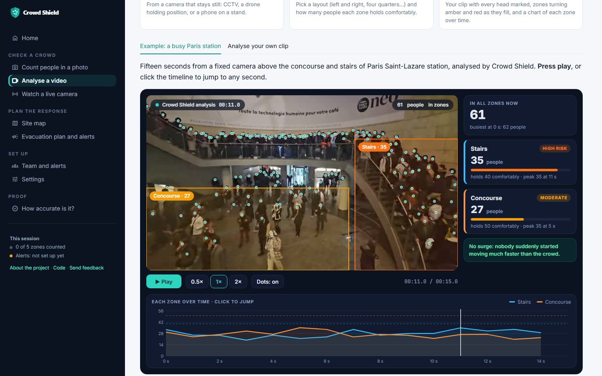

# Crowd Shield

**Try it live: [crowd-shield-india.streamlit.app](https://crowd-shield-india.streamlit.app)** · Project page: [khushi-git-7.github.io/Crowd_shield](https://khushi-git-7.github.io/Crowd_shield/) · Trained models: [Hugging Face](https://huggingface.co/Khushi-7/crowd-shield-counting) · Technical report: [PDF](paper/crowd_shield_report.pdf)

Crowd Shield helps the people running an event or a station see crowd danger
**before** it turns into a crush. It counts people in photos and video, turns
the count into **people per square metre** for each zone, measures how the
crowd is moving, and warns when a zone is heading towards a dangerous density
or when a crowd suddenly panics.

India has lost too many people this way: at the Hathras satsang in 2024, at
the New Delhi railway station in 2025, and at religious gatherings, stadium
gates and festival crowds before them. In most of these crushes the warning
signs were there minutes before: too many people per square metre, and a
crowd starting to push. Crowd Shield is an attempt to measure those signs
with ordinary cameras.

## A look at the app

| | |
|---|---|
|  |  |
| **Home.** Pick what you have: a photo, a video clip, a live camera, or the demo map. | **Analyse a video.** Every head marked, zones turning amber and red as they fill, each zone over time. |
|  |  |
| **Site map.** Zones on satellite imagery, people per m², and walking routes for moving people. | **Evacuation plan and alerts.** Each zone against its limits, and orders for every zone's team. |
|  |  |
| **Count people in a photo.** A Kumbh Mela crowd at the Sangam: 941 by the model, 957 by hand. | **How accurate is it?** Every hand-counted Indian photo, the model's count against the hand count. |

The plan screenshot uses an example session with made-up counts.

## What it does


| | |
|---|---|
| **Count people** | A point model (PET) puts a dot on every head, so it keeps working when bodies overlap and shows exactly where people are. A density-map model (DM-Count) is the fallback, and its second opinion flags suspicious counts. |
| **People per m²** | Mark a rectangle of known size on the floor once (a few tiles, a doorway, parking lines). A homography maps every pixel to real ground area, so counts become densities. |
| **Danger levels** | From crowd-safety research: about 2.2 people/m² is where normal walking breaks down (Fruin), above 5 is a serious risk (Still), and around 7 a crowd moves "almost as a fluid mass" (Fruin, quoted by Helbing et al.). |
| **Crowd pressure** | Density × local velocity variance (Helbing, Johansson and Al-Abideen, 2007). In the 2006 Hajj disaster video, turbulent pushing began above 0.02 /s², and the crush came at its peak. |
| **Early warning** | "At the current trend, Zone B reaches 5 people per m² in about 4 minutes", from a robust (Theil-Sen) trend that one bad count can't swing. |
| **Panic alarm** | Optical flow spots a crowd suddenly moving much faster than its own normal pace, or much more of the view starting to move. |
| **Zone plans and alerts** | For photos: risk per zone, an optimised plan for moving people from crowded zones into zones with room along walkable routes, and alerts by Telegram (to the user or their team group, such as the police on duty) or email (each zone's contact). |
| **Site map** | Zones drawn on satellite imagery. Each zone's ground area comes from its shape on the map (spherical-excess formula, the one Leaflet and Turf use), zones that touch become the walking routes, and the evacuation plan is drawn as animated arrows along them. |

The **Map** page opens on the bathing area at the Sangam in Prayagraj, where a
crowd crush at the Maha Kumbh on 29 January 2025 killed at least 30 people. Its
five zones are illustrative, drawn around OpenStreetMap landmarks rather than
the official Mela plan, and its "simulated surge" numbers are made up to show
every risk level. A second demo covers Madurai's Chithirai festival: the Vaigai
riverbed where Lord Kallazhagar enters the river (a crush there killed two people
in April 2022), both banks, North Masi Street and the Meenakshi Temple. A time
slider plays each simulated surge forward, and the zones can be downloaded as
GeoJSON. With real counts from the Count people in a photo page, or zones you draw yourself, it
becomes your own site's live view.

The **Analyse a video** page puts this together. It opens on an example already analysed (15 s of Paris
Saint-Lazare station): the clip itself, with a dot on every head, each zone outlined in the colour of its
risk and labelled with its live count, and a chart of each zone over time. With your own clip you pick a
zone layout (whole picture, left and right, near and far, four quarters or custom boxes) and how many people
each zone holds, and get the same annotated video back (H.264, plays in any browser, downloadable) with a
CSV of every reading. Marking a floor rectangle of known size switches the zones to people per m², and adds
walking speed, crowd pressure and time-to-danger.
It streams the clip frame by frame instead of loading it whole, so memory stays
flat however long the clip is. The hosted demo analyses up to 20 seconds (set
`CROWDSHIELD_MAX_VIDEO_S` to raise it on your own machine), and a 15-second
sample from a fixed camera at Paris Saint-Lazare station is built in: Baidax,
[CC BY-SA 4.0](https://creativecommons.org/licenses/by-sa/4.0/), via
[Wikimedia Commons](https://commons.wikimedia.org/wiki/File:2025-11-06_17-33-16_-_Paris_-_Saint-Lazare.webm).

The **Watch a live camera** page watches a camera stream (RTSP, or an HTTP stream such as HLS or MJPEG) instead of a
recorded clip. Every 30 to 300 seconds it grabs the newest frame, counts the people in each zone you drew,
colours the zone by risk, follows the trend and estimates the time until the zone is full (a Theil-Sen
trend on the counts, the same method as the video early warning). A **Demo feed** plays the Saint-Lazare
sample as if it were live, and **A real public camera** watches a live public webcam (the Blackpool seafront)
so it can be tried on a real stream with no camera of your own. Links to cameras hosted on ipcamlive.com work
too: the app looks up the camera's current stream the way the site's own player does.

It samples one frame at a time, because counting a frame with the point model takes seconds. It is not
video-rate tracking: speed, crowd pressure and the surge alarm still need the Video page and a fixed camera.
A hosted copy only runs while the page is open. To watch a camera around the clock, run it on your own
computer, with no browser:

```
python -m crowdshield.live_cli --source rtsp://192.168.1.20/stream --zones zones.json --interval 30 --log counts.csv --notify
```

Step-by-step set-up, an example zones file and the options are in [docs/run-on-your-laptop.md](docs/run-on-your-laptop.md).

(`zones.json` names each zone as a box of the picture and how many people it holds; the file's help shows the
format. A camera on your own network needs `CROWDSHIELD_ALLOW_PRIVATE_URLS=1`.) The hosted app refuses
addresses on private networks and anything other than rtsp/http(s), so it can't be pointed at the server's own
network.

**Alerts** go to Telegram (free, works on a phone) and/or email. With a bot token (`TELEGRAM_BOT_TOKEN`)
set, each user presses **Connect** in Team and alerts: a link opens the bot with a one-time code, they press
Start, and that session's alerts go to their own phone. A second link adds the bot to a Telegram group instead,
so one alert reaches a whole team, such as the police or volunteers on duty. Nobody types a token, and the bot can only write to
chats that asked for it. A team running its own copy can instead fix one chat with `TELEGRAM_CHAT_ID`; email
needs `GMAIL_USER` and `GMAIL_APP_PASSWORD`. Team and alerts has "send a test" buttons. Nothing is sent unless alerts
are switched on, and a zone is announced once per level, then quiet for 10 minutes.

### Evacuation planning

When zones are over their limit, the **Optimised** planner (the default on the Site map and the Alerts
page) works out where to send people by solving a minimum-cost network flow as a linear program
(SciPy's HiGHS solver, `crowdshield/risk.py`). Every High Risk or Critical zone must shed enough people
to drop below its limit; every other zone can take people up to just below its own limit and no
more; people may walk through zones on the way, and walking into a busy zone costs more. It first
leaves as few people as possible with nowhere to go, then minimises the walking.

The older **Simple rule** (still selectable) sends each crowded zone to its nearest zone with room, one
after another. On the two demo sites ([results/planner_comparison.md](results/planner_comparison.md)) the
two plans move the same people when there is plenty of room, but the optimiser walks them about 31% less
in the Kumbh peak. When the Madurai surge needs more room than the nearest zone has, the simple rule
quietly left about 56,000 people unplaced, while the optimiser placed everyone. (Because it places more
people, its Madurai peak plan walks more in total.) The map shows both plans side by side.

Limits: this is a static plan on a zone graph with distances between zone centres. It has no travel
time, exit widths or crowd dynamics, so treat it as a first plan for the people on the ground to adjust.

## How well it works

Every number below comes from data the method never saw while it was being
built or tuned.

### Counting people

Tested on the 498 test photos of ShanghaiTech, where every head is marked by
hand. Part A is packed crowds (433 people per photo on average), Part B is busy
streets (124 on average).


| | Packed crowds (A) | Busy streets (B) |
|---|---|---|
| Original app: YOLO boxes, faces add-on | **7%** accurate, off by 403 people per photo | **42%**, off by 72 |
| DM-Count trained for this project | **84%**, off by 70 | **86%**, off by 17 |
| PET fine-tuned for this project, with count correction (first version) | **86.5%**, off by 58.5 | **92.7%**, off by 9.0 |
| **PET, second version: also trained on UCF-QNRF (the app's counter)** | **86.1%**, off by 60.4 | **92.1%**, off by 9.8 |

*Accuracy = 1 − total counting error ÷ total true count.* Full table, per-photo
results and the code that made them: [results/shanghaitech](results/shanghaitech),
[eval/evaluate_counting.py](eval/evaluate_counting.py),
[eval/compare_counting.py](eval/compare_counting.py).

How the counter was built:

- **PET** (Liu et al., ICCV 2023) started from its authors' JHU-Crowd++ model,
  which had never seen ShanghaiTech, and was fine-tuned for 9.5 hours on a free
  Kaggle GPU. The best round (240) was picked on 70 held-out training photos.
- **One count correction**, true ≈ 1.375 × raw^0.942, was fitted on those same
  70 held-out photos. It trims PET's overcounting in packed crowds and its
  undercounting on streets. Fitting it on the test photos would have been cheating.
- On packed crowds the error (58.5 people per photo) is a little better than
  the DM-Count paper's 59.7, but behind PET's own paper (49.1), which picked its
  best round on the test set and trained a separate model per part.
- PET isn't better everywhere: on the very largest crowds (1,000+ people) DM-Count
  is slightly more accurate (85% against 83%).

What we learned along the way:

- **The original detector ignored crowds.** The standard YOLOv8 model counted
  13–21 people in most photos whether the photo held 9 people or 539. It was
  trained on COCO, where a tightly packed group is labelled as one "crowd" region
  and left out of YOLO's training labels, so it learned to treat crowds as background.
- **A suspected bug mattered less than expected.** Ultralytics keeps at most
  300 boxes per image by default. Raising that limit changed only 1 of 498 photos,
  because the detectors almost never found 300 people to begin with.
- **The faces add-on wasn't worth it.** It added about 5 people per photo and
  made counting 2–6× slower, so it's off by default (OpenCV 5 also dropped it).
- **Honest model selection.** DM-Count's and PET's own scripts pick the best
  training round by looking at the test photos. Here 10% of the *training*
  photos were held back to pick it, so the test photos stayed unseen.

The second version is level with the first on ShanghaiTech (the differences are within noise, see
below) and far better on Indian crowds.

The trained models are published as releases ([PET](https://github.com/khushi-git-7/Crowd_shield/releases/tag/pet-qnrf-v1),
[first PET](https://github.com/khushi-git-7/Crowd_shield/releases/tag/pet-shab-v1),
[DM-Count](https://github.com/khushi-git-7/Crowd_shield/releases/tag/dmcount-shab-v1))
and download automatically, with a checksum check, the first time the app counts.

### Counting Indian crowds

ShanghaiTech is Chinese photography, so Crowd Shield also has its own **India test set**:
105 freely licensed Wikimedia Commons photos of melas, festivals (including Madurai's
Chithirai festival), temples, stations, markets, stadiums and ghats, credited in
[data/india_test](data/india_test). They are never used for training. Every head is being
marked by hand, with ignore zones over people too far away to mark.

On the first 10 hand-checked photos (3,507 people) the first counter was only **66.7%** accurate,
because of one failure: on a Mumbai railway photo it counted the gravel between the tracks as heads
(1,267 against 415). A first fix, fine-tuning on those 10 photos and 23 photos of empty Indian tracks,
fixed that photo but made the model miss people in smaller crowds, so it was not used.

**The second version fixes it without touching the Indian test photos.** It was fine-tuned on
ShanghaiTech (packed crowds twice over, so it would not forget them), the 1,201 dense and varied
UCF-QNRF training photos, and the 23 empty-track photos as about 1% of the set. No Indian crowd photo
was trained on. Every model was compared through the app's own counting code
([eval/compare_models.py](eval/compare_models.py), [results/model_v2](results/model_v2)):

| Test | First version | Second version | Difference, 95% interval |
|---|---:|---:|---|
| Indian photos (10), full detail | 66.6% | **91.6%** | +24.9 points (−3.6 to +84.9) |
| Indian photos (10), online server | 67.9% | **86.1%** | +18.2 points (−1.4 to +61.9) |
| UCF-QNRF test (334) | 82.8% | **85.5%** | **+2.7 points (+1.1 to +4.4)** |
| ShanghaiTech A test (182) | 86.4% | 86.1% | −0.4 points (−2.2 to +1.3) |
| ShanghaiTech B test (316) | 93.3% | 92.8% | −0.4 points (−1.1 to +0.3) |

The intervals come from a paired bootstrap over the test photos
([eval/bootstrap_compare.py](eval/bootstrap_compare.py)). The rule, set before the test, was to switch
only if the ShanghaiTech interval included zero: it did, so the drop there is within noise. The gain on
UCF-QNRF is real. The Indian gain is large, but 10 photos are too few to prove it, so labelling the rest
of the India set comes next. The Mumbai photo is now counted as 455 (full detail) or 629 (online server).

The **How accurate is it?** page in the app shows per-scene accuracy and every photo with the true and
the model's head points (91.1% overall at full detail; the hardest photo is now Thane station, counted
too low: 311 against 425).

### Spotting panic

Tested on the University of Minnesota crowd-escape videos: 11 clips in 3
scenes, each ending with everyone suddenly running away.


- **11 of 11 escapes caught, no false alarms**, a median 0.7 s before the
  dataset's own "abnormal" label appears. Looking at the frames, the label runs
  about a second late, so alarms up to 2 s before it count as catches.
- Speed alone missed three escapes in the indoor hall, where the camera is far
  away and running people only look 1.4–2× faster. A second signal, how much
  of the view is moving, catches them.
- To check that its level (8× normal) wasn't simply tuned to these clips, each
  scene was held out in turn: the level was chosen on the other two scenes and
  tested on the held-out one. It chose 8× every time and caught every held-out
  escape with no false alarms.
- Caveat: 11 clips from 3 scenes is a small test, and in one indoor clip the
  score briefly touches the alarm line while people are still walking. It
  doesn't fire, because the alarm needs half a second above the line, but the
  margin there is small.

Details: [results/umn](results/umn), [eval/evaluate_motion.py](eval/evaluate_motion.py).

### Indian video, in the field

To see how the video side copes outside the lab, it was run on 15 freely licensed Wikimedia
Commons clips of Indian crowds: Holi in Howrah (2026), the Bhagoriya fair in Ranapur (2026),
Gangasagar pilgrims in Kolkata (2013), a solar-eclipse crowd in Kozhikode and a railway
platform. There's no hand count for these clips, so this is a field check, not an accuracy test.


- **Counting holds up.** Head points land on heads in packed, colourful, partly covered crowds
  (sarees and shawls included), from 10 to 330 people per frame.
- **Every clip was filmed on a handheld phone,** and that matters. With a moving camera the
  whole picture slides, so "crowd speed" and the panic alarm measure the camera, not the crowd.
  Crowd Shield now checks for this (phase correlation: how far the whole frame shifts). The
  fixed UMN camera scores at most 1.4% of the frame width per second even while people run,
  and these clips score 8 to 36%. Above 5%, the Video page says so and switches speed, pressure
  and the alarm off, while still counting people.
- **Speed:** on a free Kaggle T4 GPU, analysing a clip took about 1.4 seconds per second of
  video, with one count per second.

Clip list, credits and numbers: [results/india_video/clips.csv](results/india_video/clips.csv).

### Speed without a GPU

On a plain cloud CPU (Intel Xeon, 4 cores, 2 PyTorch threads, no GPU), over the 21 original India
test photos ([results/cpu_speed.json](results/cpu_speed.json)):

| Model | Photos resized to | Median time per photo | Memory (both models loaded) |
|---|---|---|---|
| PET point model (the app's counter) | 1280 px | 16 s | 4.3 GB |
| DM-Count density model | 1280 px | 8 s | 4.3 GB |
| PET point model | 2048 px | 38 s | 9.0 GB |

So an ordinary 8 GB laptop can count photos, but not live video: video needs a GPU (about 1.4 s
per second of video on a free T4).

**Memory sets the photo size.** PET's memory grows with pixel count. Measured alone, one model in a
fresh process ([results/pet_memory.json](results/pet_memory.json)):

| Photos resized to | 640 px | 800 px | 1024 px | 1280 px | 1600 px | 2048 px |
|---|---|---|---|---|---|---|
| PET peak memory | 1.5 GB | 2.4 GB | 2.8 GB | 3.6 GB | 5.4 GB | 8.4 GB |

Streamlit Community Cloud gives an app about 2.7 GB, so on it (or any machine with under 6 GB)
Crowd Shield counts at 640 px; elsewhere it uses 2048 px. On the four test photos the counts at
640 px stayed close to those at 2048 px. `CROWDSHIELD_MAX_SIDE` overrides the choice.

### Counting on a small server: tiles

*The measurements in this section and the next were made with the first point model. The second one
has the same size and speed; its accuracy online is in the comparison above.*

The free host has 3.2 GB of memory, too little to run the point model on a 1024 px photo in one pass.
Shrinking photos to fit (704 px) cost accuracy. Instead, a small server now shrinks photos to 1024 px and
counts them in tiles of at most 704 px, each with 48 px of overlap, keeping every head only in the tile
whose core contains it (`points.points_tiled`). Measured on Kaggle ([results/tiled_accuracy.json](results/tiled_accuracy.json),
[results/tiled_memory.json](results/tiled_memory.json)):

| | ShanghaiTech A | ShanghaiTech B | Peak memory | Time per photo (4-core CPU) |
|---|---:|---:|---:|---:|
| One pass at 704 px (before) | 83.6% | 91.9% | 1.9 GB | 7 s |
| **Tiles, 1024 px (now)** | **86.1%** | **93.3%** | **1.5 GB** | 21 s |
| One pass at 1024 px (needs a bigger server) | 86.5% | 92.7% | 2.9 GB | 12 s |

So the hosted app now counts about as well as a big server, in less memory, but about three times slower.
On the 10 hand-labelled Indian photos the smaller 704 px pass scored higher (81.9% vs 68.6% tiled and
66.6% at 2048 px), because shrinking hides the railway-gravel failure; with 10 photos that is a hint, not a result.

**Tiles that fit PET's padding.** PET pads every input up to a multiple of 256 px, so a 704 px square tile is
really computed as 768 x 768, mostly padding. The tile plan now picks the split with the least padded area
whose every tile still fits the same memory: a 1024 x 768 photo becomes two full-width strips instead of
four squares. On a CPU set up like the free server (2 threads; [results/tile_plan_speed.json](results/tile_plan_speed.json),
[results/tile_plan_accuracy.json](results/tile_plan_accuracy.json)):

| Tile plan | Tiles (SH A) | ShanghaiTech A | ShanghaiTech B | India (10) | Median time per photo | Peak memory |
|---|---:|---:|---:|---:|---:|---:|
| Squares (before) | 444 | 86.1% | 93.3% | 68.6% | 22.1 s | 1.95 GB |
| **Padded strips (now)** | **241** | **86.4%** | **93.25%** | 67.9% | **15.4 s** | **1.89 GB** |

About 30% faster in slightly less memory, with ShanghaiTech accuracy unchanged within noise.

### A second opinion on suspicious counts

The point model's known failure is dots on things that are not heads: railway gravel, waves on the horizon,
rows of advertising boards. The density model (DM-Count) fails differently, so after counting a photo the
app also runs DM-Count on it at 768 px. When PET counts more than 2.5 times as many people (and at least 50),
the result says "Check this count" and asks the user to look at the dots. The count itself is still PET's.
Measured on Kaggle over 603 photos ([results/second_opinion.json](results/second_opinion.json)):

| Photos | Flagged |
|---|---|
| 498 ShanghaiTech test photos | 0 |
| 9 well-counted hand-labelled Indian photos | 0 |
| Mumbai railway photo (PET 1,282, true 415) | flagged |
| 95 Indian photos without a hand count | 1 (a stadium: a band of dots along the advertising boards) |

It adds about 3 s per photo, and runs only when at least 700 MB of memory is free, so it cannot crash a
small server; `CROWDSHIELD_SECOND_OPINION=0` turns it off. With one confirmed failure to learn from, this
is a cautious first rule, to be re-checked as more Indian photos are labelled.

Re-run with the second point model ([results/model_v2/second_opinion.json](results/model_v2/second_opinion.json)):
still 0 of the 498 ShanghaiTech photos, and the Mumbai photo is no longer flagged because it is now counted
about right. Of the 95 unlabelled Indian photos it flags one, a false alarm: a crowd of about 8,000 where both
models agree at full size, but DM-Count undercounts once the photo is shrunk to 768 px.

## Run it

```bash
pip install -r requirements.txt
streamlit run main.py
```

Python 3.10+. The two counting models (PET and DM-Count) need PyTorch, which
`requirements.txt` installs (CPU build); their weights download on first use
(see [models/README.md](models/README.md)). The original YOLO detectors are an
optional last fallback: `pip install ultralytics dill` to use them. Alerts need
`TELEGRAM_BOT_TOKEN` (plus `TELEGRAM_CHAT_ID` for one fixed chat), or `GMAIL_USER`
and `GMAIL_APP_PASSWORD`, as environment variables; see Team and alerts in the app.

Tests: `pytest`. GitHub Actions also runs the real detector and density model
and renders every page.

## How it's built

```
crowdshield/          the core, with no UI code
  detection.py        YOLO boxes; the app's count (point model, then density model, then YOLO)
  points.py           PET point model and its count correction
  pet/                PET's network code (MIT licence), adapted to run on CPU
  density.py          DM-Count network
  weights.py          downloads trained weights from the releases, with checksums
  geometry.py         camera calibration: homography, pixel areas, ground speed
  safety.py           people per m², danger levels, crowd pressure
  motion.py           optical flow statistics and the panic alarm
  monitor.py          the video monitor: per-zone readings every second
  forecast.py         time until a zone reaches 5 people per m²
  risk.py             zone risk levels, relocation plans and walking routes
  geo.py              zones on a map: ground area, centres, which zones touch
  sitemap.py          a mapped site's densities, risk and evacuation routes
sites/                map sites (the Kumbh demo)
eval/                 the accuracy tests behind every number above
pages/                the Streamlit app: Agents, Upload, Analysis, Video, Map, Settings
results/              test results, per photo and per clip
```

## Privacy and ethics

Crowd Shield is built to answer "how many people, where, and how fast are they
moving?", never "who is this?".

- **No faces, no identities.** The point model puts an anonymous dot on each
  head. There is no face recognition and nothing in the app tries to tell one
  person from another. Video analysis measures movement per zone (optical
  flow), not the path of any individual.
- **Nothing is stored.** Uploaded photos and clips stay in memory for your
  browser session only. The app keeps no database and writes no photos to
  disk; a video clip is written to a temporary file only while OpenCV decodes
  it, then deleted. Closing the tab clears the rest. On the hosted demo, processing
  happens on Streamlit Community Cloud's servers; use your own copy for
  sensitive footage.
- **What can leave the app.** Only the email alerts, and only if you set them
  up: they send zone staff the counts, the orders and the busiest photo with
  its dots. Everything else stays on screen.
- **The old face add-on is off.** The original app could add Haar face
  detections (finding faces, not recognising them) to catch hidden heads. It
  is off by default, isn't offered in the app, and the head-point model made
  it unnecessary.
- **Data we used.** Public research datasets (ShanghaiTech, UMN) and freely
  licensed Wikimedia Commons photos, each credited. The Indian test labels are
  head positions only.
- **Data minimisation by design.** Keeping only aggregate counts follows the
  GDPR principle of data minimisation (Article 5(1)(c)). A real deployment
  would still need a data protection impact assessment (Article 35), visible
  signage, a retention policy and a trained operator.
- **A tool for people, not instead of them.** Counts can be wrong, as the
  railway-gravel case shows. Alerts are prompts for a trained person to look,
  and Crowd Shield shouldn't be the only safety measure at any event. It
  shouldn't be used to watch individuals.

## Limits

- The India test is a pilot: 10 of its 105 photos are hand-checked so far, and the counter
  can still miscount unusual scenes (it counts the Thane station photo too low). The Indian gain of
  the second model is large but not yet statistically proven on 10 photos.
- Density needs a calibrated, fixed camera. A moving phone video gives counts
  and speeds in pixels only.
- The early warning extends the recent trend in a straight line. It is a
  prompt for a human to look, not a prediction of the future.
- It has not been used at a real event or by real staff yet. [docs/user-testing.md](docs/user-testing.md) is
  a 15-minute test to run with someone who works with crowds, and the app has a feedback form.
- The hosted demo runs on free hosting: it sleeps when unused (about a minute to wake, after pressing its wake-up button), has 3.2 GB of memory, so
  it counts large photos in pieces (same accuracy), and takes about 30 seconds on a new photo.

## Team and credits

Crowd Shield began as a group project by **Khushi Jain** ([@khushi-git-7](https://github.com/khushi-git-7))
and [@SasmitaRK](https://github.com/SasmitaRK). Khushi researched, tested and
picked the VisDrone-trained YOLO model and built the first prototype; Sasmita
built the app's interface. Version 2 (counting accuracy, real units, crowd
pressure, video and the evaluations) is Khushi's work on this fork.

Built on: [PET](https://github.com/cxliu0/PET) (Liu et al., ICCV 2023, MIT licence,
for academic use), [DM-Count](https://github.com/cvlab-stonybrook/DM-Count) (Wang et al.,
NeurIPS 2020, MIT licence), [Ultralytics YOLO](https://github.com/ultralytics/ultralytics),
[ShanghaiTech](https://github.com/desenzhou/ShanghaiTechDataset) (Zhang et al.,
CVPR 2016), the [UMN unusual crowd activity](http://mha.cs.umn.edu/) videos,
and the crowd-safety research of J. J. Fruin, G. K. Still, and D. Helbing,
A. Johansson and H. Z. Al-Abideen (Phys. Rev. E 75, 046109, 2007).
